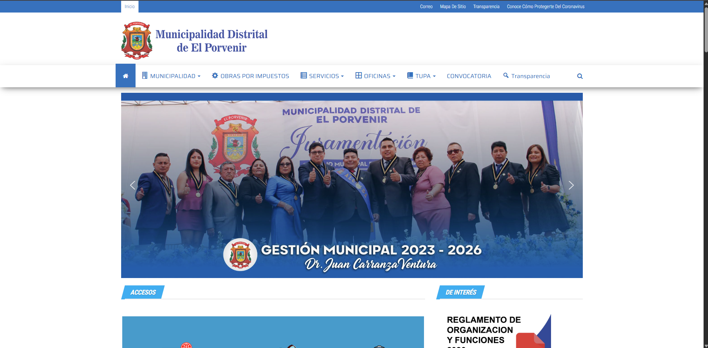
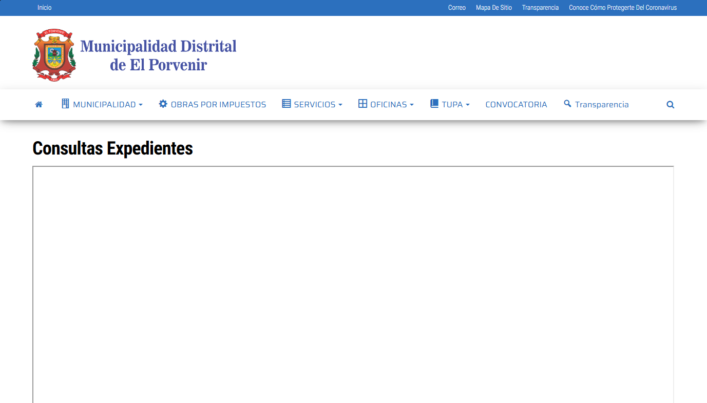
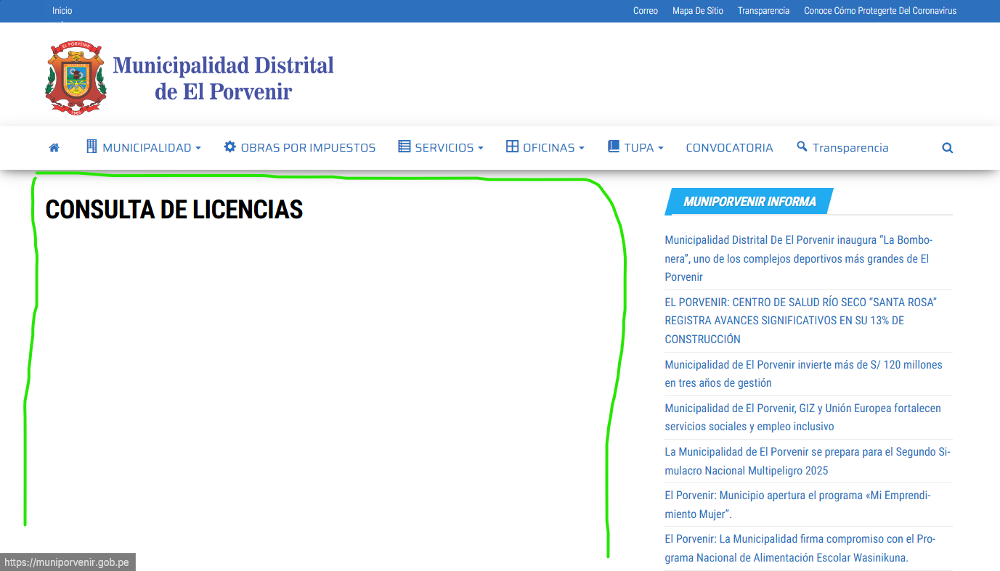
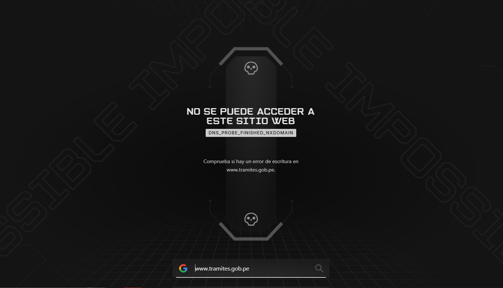

# Laboratorio N° 11: Diagnóstico de usabilidad y rediseño de interfaces

**Repositorio GitHub:** [https://github.com/josueshadow-24/lab11-diagnostico-ux.git](https://github.com/josueshadow-24/lab11-diagnostico-ux.git)

---

## Paso 1: Selección de la interfaz y definición de la tarea

### 1.1 Sitio web seleccionado
* **Nombre del sitio:** Municipalidad Distrital de El Porvenir
* **URL:** [https://muniporvenir.gob.pe/](https://muniporvenir.gob.pe/)
* **Justificación de elección:** La interfaz presenta serios problemas de usabilidad, como un contraste de texto muy bajo en las barras superiores de navegación, saturación de elementos informativos en la portada y falta de jerarquía visual limpia para trámites y servicios de alta demanda ciudadana.

### 1.2 Capturas de Pantalla Base
* **Vista Escritorio (Desktop 1440px):** 

* **Vista Móvil (Mobile 390px):**
* 
    

### 1.3 Definición de la tarea del usuario
* **Tarea a realizar:** Consultar la validez de una licencia de funcionamiento o el estado de un expediente municipal desde el menú de Servicios.
* **Métricas iniciales de ejecución (Sitio Original):**
  * **Pasos / Clics requeridos:** 3 clics (Inicio ➔ Menú Servicios ➔ Consulta de Licencias / Expedientes).
  * **Tiempo aproximado:** El usuario pasa más de 2 minutos intentando recargar al encontrarse con una pantalla en blanco.
  * **Dificultad percibida:** Super alta, ya que no existe retroalimentación visual, mensaje de error ni indicador de carga.

---

## Paso 2: Evaluación heurística (5 heurísticas de Nielsen)

### 2.1 H1: Visibilidad del estado del sistema
* **Pregunta guía:** ¿El sistema informa qué está pasando (carga, envío, página actual)?
* **Infracción detectada:** Al presionar opciones del menú como "Consulta de Licencias" o "Consultas Expedientes", la pantalla se queda completamente en blanco sin mostrar un indicador de carga, mensaje de espera ni confirmación del estado de la petición.
* **Evidencia:** 

### 2.2 H2: Relación entre el sistema y el mundo real
* **Pregunta guía:** ¿Usa el lenguaje del usuario y no términos técnicos o internos?
* **Infracción detectada:** El menú de navegación muestra siglas y lenguaje puramente de oficinas o municipalidad (como "TUPA" o "CIAM"). Sería mejor utilizar expresiones claras que cualquier ciudadano entienda fácilmente, por ejemplo "Requisitos de trámites" o "Adulto mayor".
* **Evidencia:** 

### 2.3 H4: Consistencia y estándares
* **Pregunta guía:** ¿Los mismos elementos se ven y se comportan igual en todo el sitio?
* **Infracción detectada:** Se aprecian diferencias en la tipografía y en el diseño visual de los submenús. Además, la barra superior de accesos utiliza estilos de enlaces distintos a los del menú principal, y algunos botones no ofrecen una respuesta visual uniforme al pasar el cursor por encima.
* **Evidencia:** 

### 2.4 H5: Prevención de errores
* **Pregunta guía:** ¿La interfaz evita que el usuario se equivoque o llegue a estados fallidos?
* **Infracción detectada:** El sitio permite al usuario navegar hacia páginas no disponibles o en mantenimiento dentro del menú "Servicios" sin advertir previamente que la sección no se encuentra operativa, llevando al usuario a un punto muerto.
* **Evidencia:** 
  

### 2.5 H8: Diseño estético y minimalista
* **Pregunta guía:** ¿Hay información o elementos que compiten con lo realmente importante?
* **Infracción detectada:** El carrusel de imágenes institucional ocupa excesivamente la pantalla inicial, desplazando los accesos a servicios y trámites principales fuera de la primera vista del usuario.
* **Evidencia:** 