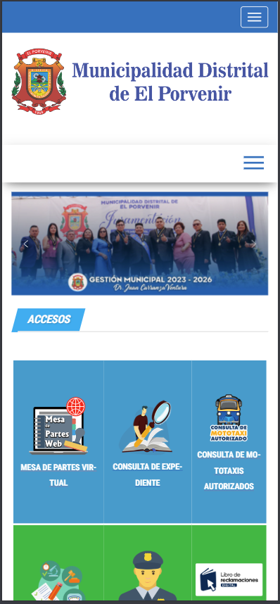

# Laboratorio N° 11: Diagnóstico de usabilidad y rediseño de interfaces

**Curso:** Diseño de Interfaces de Programación Avanzado  
**Estudiante:** Josué  
**Repositorio GitHub:** .pendiente.  

---

## Paso 1: Selección de la interfaz y definición de la tarea

### 1.1 Sitio Web Seleccionado
* **Nombre del sitio:** Municipalidad Distrital de El Porvenir
* **URL:** [https://muniporvenir.gob.pe/](https://muniporvenir.gob.pe/)
* **Justificación de elección:** La interfaz presenta serios problemas de usabilidad, como un contraste de texto muy bajo en las barras superiores de navegación, saturación de elementos informativos en la portada y falta de jerarquía visual limpia para trámites y servicios de alta demanda ciudadana.

### 1.2 Capturas de Pantalla Base
* **Vista Escritorio (Desktop 1440px):** 

* **Vista Móvil (Mobile 390px):**
* 
    

### 1.3 Definición de la tarea del usuario
* **Tarea a realizar:** Consultar la validez de una licencia de funcionamiento o el estado de un expediente municipal desde el menú de Servicios.
* **Métricas iniciales de ejecución (Sitio Original):**
  * **Pasos / Clics requeridos:** 3 clics (Inicio ➔ Menú Servicios ➔ Consulta de Licencias / Expedientes).
  * **Tiempo aproximado:** El usuario pasa más de 2 minutos intentando recargar al encontrarse con una pantalla en blanco.
  * **Dificultad percibida:** Super alta, ya que no existe retroalimentación visual, mensaje de error ni indicador de carga.