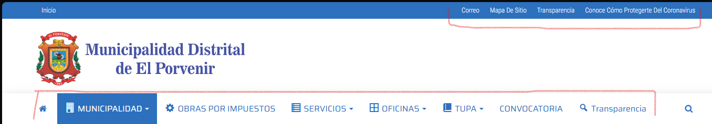
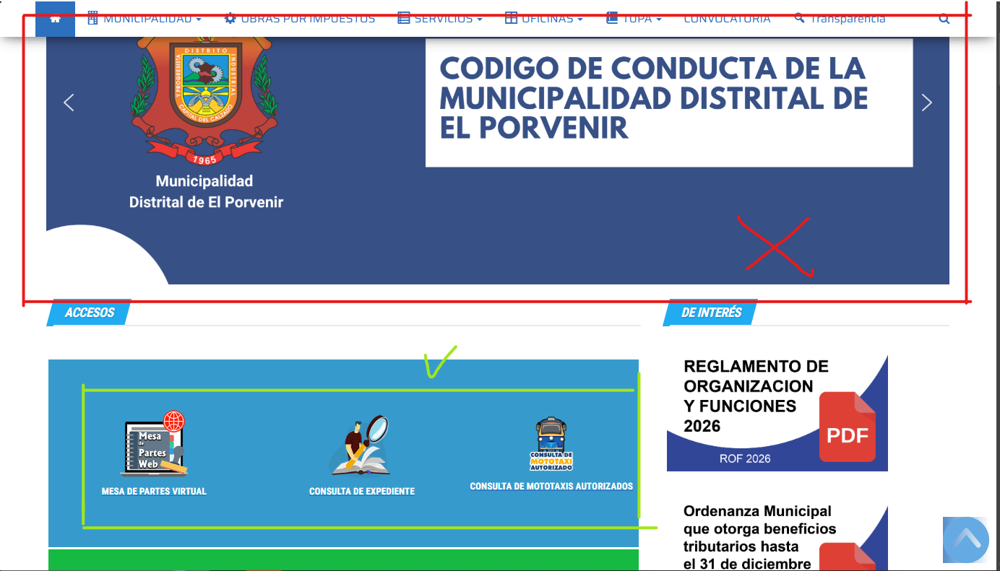
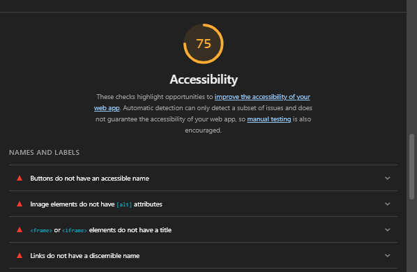
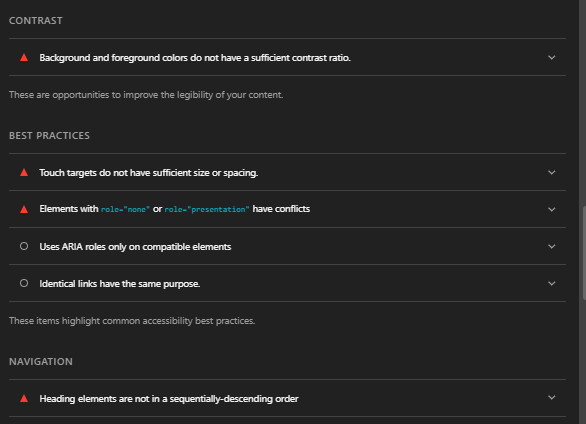

# Laboratorio N° 11: Diagnóstico de usabilidad y rediseño de interfaces

**Repositorio GitHub:** [https://github.com/josueshadow-24/lab11-diagnostico-ux.git](https://github.com/josueshadow-24/lab11-diagnostico-ux.git)

---

## Paso 1: Selección de la interfaz y definición de la tarea

### 1.1 Sitio web seleccionado
* **Nombre del sitio:** Municipalidad Distrital de El Porvenir
* **URL:** [https://muniporvenir.gob.pe/](https://muniporvenir.gob.pe/)
* **Justificación de elección:** La interfaz presenta serios problemas de usabilidad, como un contraste de texto muy bajo en las barras superiores de navegación, saturación de elementos informativos en la portada y falta de jerarquía visual limpia para trámites y servicios de alta demanda ciudadana.

### 1.2 Capturas de Pantalla Base
* **Vista Escritorio (Desktop 1440px):** 

* **Vista Móvil (Mobile 390px):**
* 
    

### 1.3 Definición de la tarea del usuario
* **Tarea a realizar:** Consultar la validez de una licencia de funcionamiento o el estado de un expediente municipal desde el menú de Servicios.
* **Métricas iniciales de ejecución (Sitio Original):**
  * **Pasos / Clics requeridos:** 3 clics (Inicio ➔ Menú Servicios ➔ Consulta de Licencias / Expedientes).
  * **Tiempo aproximado:** El usuario pasa más de 2 minutos intentando recargar al encontrarse con una pantalla en blanco.
  * **Dificultad percibida:** Super alta, ya que no existe retroalimentación visual, mensaje de error ni indicador de carga.

---

## Paso 2: Evaluación heurística (5 heurísticas de Nielsen)

### 2.1 H1: Visibilidad del estado del sistema
* **Pregunta guía:** ¿El sistema informa qué está pasando (carga, envío, página actual)?
* **Infracción detectada:** Al presionar opciones del menú como "Consulta de Licencias" o "Consultas Expedientes", la pantalla se queda completamente en blanco sin mostrar un indicador de carga, mensaje de espera ni confirmación del estado de la petición.
* **Evidencia:** 

### 2.2 H2: Relación entre el sistema y el mundo real
* **Pregunta guía:** ¿Usa el lenguaje del usuario y no términos técnicos o internos?
* **Infracción detectada:** El menú de navegación muestra siglas y lenguaje puramente de oficinas o municipalidad (como "TUPA" o "CIAM"). Sería mejor utilizar expresiones claras que cualquier ciudadano entienda fácilmente, por ejemplo "Requisitos de trámites" o "Adulto mayor".
* **Evidencia:** 

### 2.3 H4: Consistencia y estándares
* **Pregunta guía:** ¿Los mismos elementos se ven y se comportan igual en todo el sitio?
* **Infracción detectada:** Se aprecian diferencias en la tipografía y en el diseño visual de los submenús. Además, la barra superior de accesos utiliza estilos de enlaces distintos a los del menú principal, y algunos botones no ofrecen una respuesta visual uniforme al pasar el cursor por encima.
* **Evidencia:** 

### 2.4 H5: Prevención de errores
* **Pregunta guía:** ¿La interfaz evita que el usuario se equivoque o llegue a estados fallidos?
* **Infracción detectada:** El sitio permite al usuario navegar hacia páginas no disponibles o en mantenimiento dentro del menú "Servicios" sin advertir previamente que la sección no se encuentra operativa, llevando al usuario a un punto muerto.
* **Evidencia:** 
  

### 2.5 H8: Diseño estético y minimalista
* **Pregunta guía:** ¿Hay información o elementos que compiten con lo realmente importante?
* **Infracción detectada:** El carrusel de imágenes institucional ocupa excesivamente la pantalla inicial, desplazando los accesos a servicios y trámites principales fuera de la primera vista del usuario.
* **Evidencia:** 

---

## Paso 3: Análisis de jerarquía visual y accesibilidad

### 3.1 Prueba de los 5 segundos y squint test (entrecerrado)
* **Prueba de los 5 segundos:** Al mostrar la portada durante 5 segundos a un compañero, lo primero que recuerda es la fotografía institucional, sin identificar claramente dónde realizar trámites ni cuál es la acción principal del portal.
* **Squint test (Prueba del entrecerrado):** Lo que más salta a la vista por su tamaño y sus colores llamativos es la imagen grande (el carrusel). Esto no coincide con lo que el ciudadano realmente busca hacer primero, como pagar sus arbitrios, ver licencias o hacer consultas.

### 3.2 Evaluación de contraste (WCAG 2.2 Nivel AA - WebAIM)
* **Combinación 1 (Texto de menú azul sobre fondo azul claro/blanco):**
  * *Valores:* `#5B8AC2` sobre `#FFFFFF`
  * *Relación de contraste:* `2.7:1` falla, ya que no alcanza el mínimo de 4.5:1 exigido para texto normal.
* **Combinación 2 (Texto de barra superior blanca sobre azul):**
  * *Valores:* `#A3C6EA` sobre `#2B6CB0`
  * *Relación de contraste:* `3.2:1` falla, ya que la legibilidad es deficiente.
* **Combinación 3 (Texto blanco en el pie de página sobre fondo azul medio):**
  * *Valores:* `#FFFFFF` sobre `#3174C7`
  * *Relación de contraste:* `3.4:1` falla, ya que no alcanza el `4.5:1` exigido por WCAG 1.4.3 para texto pequeño.

### 3.3 Tamaño de abjetivos táctiles (vista móvil - 390px)
* **Evaluación criterio WCAG 2.5.8:** Los enlaces del submenú "Servicios" y "TUPA" presentan una altura de apenas `18px` a `20px` con un espaciado interlineal mínimo.
* **Problema:** Los elementos son más pequeños de la medida recomendada de `24 × 24 px`, lo que hace que sea difícil tocarlos con el dedo en el celular y se puedan presionar por error.

### 3.4 Auditoría automática con lighthouse (DevTools)
* **Puntaje de accesibilidad:** `75 / 100` 
* **Evidencia:** 

* **Principales fallos detectados:**
  1. Botones sin nombre accesible, imágenes sin atributo `alt` y enlaces sin texto descriptivo.
  2. Los colores de fondo y primer plano no cumplen con la relación de contraste mínima.
  3. Botones y enlaces con tamaño o espaciado insuficiente para la interacción en pantallas táctiles.
  4. Encabezados con orden no secuencial.

### 3.5 Incumplimiento de Leyes de UX
* **Ley de Fitts:** Los botones y enlaces principales son diminutos y se ubican en zonas difíciles de alcanzar rápidamente en vista móvil.
* **Ley de Hick:** Demasiadas opciones presentadas de manera simultánea en el menú principal sin una jerarquía por demanda o uso frecuente, aumentando el tiempo de decisión.
* **Ley de Jakob:** El portal rompe el patrón mental común de sitios de trámites (donde los servicios en línea se destacan al centro o parte superior mediante tarjetas bien diferenciadas).
* **Ley de Proximidad:** Elementos de servicios están agrupados junto a información de noticias institucionales sin fronteras ni márgenes claros de separación.

### 3.5 Incumplimiento de las 5 Leyes de UX
1. **Ley de Fitts:** Los botones y enlaces del menú para celulares son muy pequeños y están muy pegados entre sí, lo que dificulta atinarle a la opción que deseas y hace que uno se equivoque fácilmente al tocar con el dedo.
2. **Ley de Hick:** El menú y la página principal muestran demasiados enlaces y anuncios al mismo tiempo y sin orden de importancia, lo que hace que el ciudadano se demore mucho más tiempo en decidir a dónde ir.
3. **Ley de Jakob:** La página no sigue la costumbre que la gente ya conoce en otros sitios web municipales modernos, donde los trámites más buscados (como licencias o impuestos) se ponen de forma limpia y directa en tarjetas al centro.
4. **Ley de Miller:** Hay demasiada información junta en la pantalla y no está dividida en grupos pequeños (de máximo 5 a 7 cosas), lo que satura la mente del usuario al mostrarle listas larguísimas de enlaces sin separar por temas.
5. **Ley de Proximidad:** Los enlaces de servicios públicos, avisos de la municipalidad y noticias están amontonados unos al lado de otros, sin bordes ni espacios que ayuden a distinguir qué elementos van juntos.